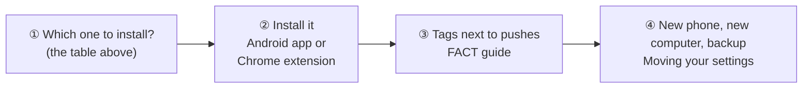
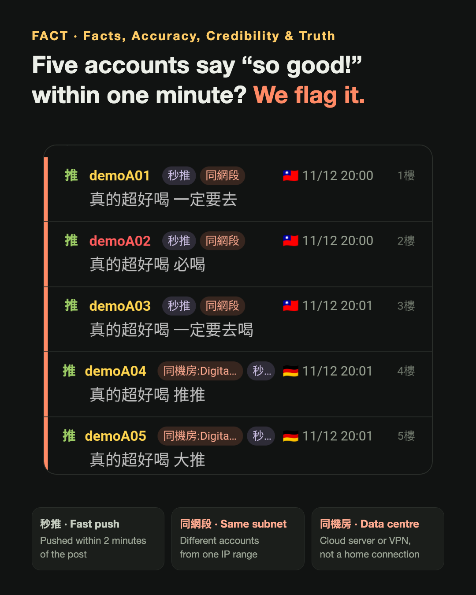
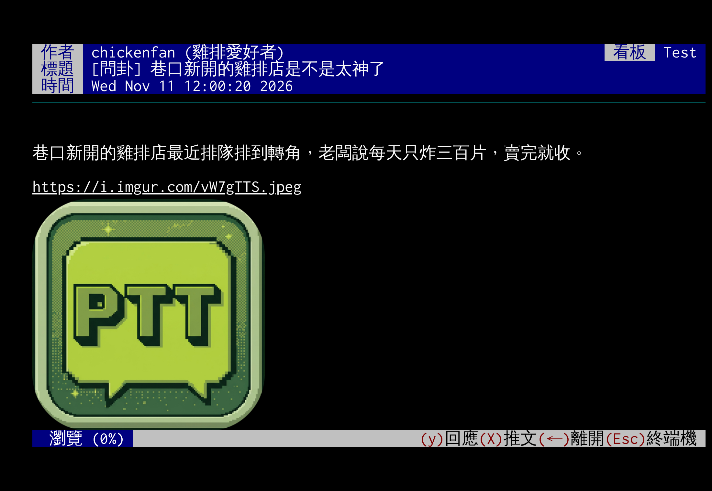

# JJptt

[中文](README.md) | **English** | [日本語](README.ja.md)

[](https://github.com/killnopig/JJptt/releases/tag/android-stable) [](docs/desktop.en.md) [](https://ko-fi.com/killnopig)

**JJptt is a free tool for reading PTT.** It makes PTT articles easier to read, and it points out signs that someone may be trying to steer the conversation.

> PTT is one of Taiwan's biggest online forums. The comments under an article are called "pushes".
> "Steering" means a group of people posting lots of comments on purpose, so that one opinion looks like what most people think.

<a name="get-jjptt"></a>

## Which one should I install?

| You use | Install this | How hard |
|---|---|---|
| **An Android phone** | [Android app](docs/android.en.md) | Easy: download one file and open it |
| **A computer** (Chrome, Edge, Brave, Arc or Vivaldi browser) | [Chrome extension](docs/desktop.en.md) | Follow the steps once, about 5 minutes |
| **An iPhone** | Not yet: [why, and how to help](docs/android.en.md#about-an-ios-version) | |

<a name="guides"></a>

## 📚 Guides: read them in this order



1. **Decide which one to install**: see the "Which one should I install?" table above.
2. **Install it and start using it**
   - Phone: [Android app](docs/android.en.md): download, install, update, what the app does.
   - Computer: [Chrome extension](docs/desktop.en.md): step-by-step install, first use, updating, what to do when something goes wrong.
3. **You see tags like 秒推 or 同網段 next to pushes and want to know what they mean**: [FACT guide](docs/fact.en.md). Start with "First, to be clear" and the "Glossary" at the top.
4. **A new phone, a new computer, or you want a backup**: [Moving your settings](docs/settings-file.en.md).
5. **What changed lately**: [Changelog](CHANGELOG.md) (in Chinese).

## Who is steering the thread? JJptt shows you at a glance.

Sometimes it looks as if everyone under an article agrees, but it's really a few people who planned to comment together. For example:

- Within one minute, five accounts say almost the same thing.
- Several accounts go online from the same place. (Every device online has an "IP", like a house number on the internet. Numbers that are very close may mean the same group of people.)
- The person commenting goes online from a "data centre" abroad. Ordinary people rarely do that; it's often a way to hide where they really are.

These are hard to spot by eye. JJptt marks them right next to the pushes.

<p align="center">
  
  
</p>

**Free, no ads, no data collected.** All the code is public (open source), so anyone can check it. (JJptt's screens are in Traditional Chinese.)

### Why JJptt

| | |
|---|---|
| 🔍 **[Catch steering](docs/fact.en.md)** | Suspicious pushes are flagged for you: pushed too fast, a crowd arriving at once, the same words, the same place or a data centre. No counting by hand |
| 🤖 **Ask AI in one tap** | Hand the whole article to ChatGPT, Claude or another AI. Or select a passage and ask "Is this true?" |
| 🔒 **Nobody in between** | Connects straight to PTT, with no one else's server in the middle. Your ID and password stay on your own computer or phone |
| 📖 **Easy to read** | Images, videos and news show right inside the article. The next article is loaded ahead, so it opens at once |
| 🎨 **Pushes at a glance** | Floors, flags, and how many times one person pushed are all colour-coded. People you'd rather not read can go on a blacklist, faded or hidden |
| 🔄 **Settings travel with you** | Settings on your computer can move to your phone. A layout you like on the phone becomes a short code you can share with friends |

## 📱 Android app

> **Want to know about the Android app?** Download it and it works, nothing else to install. Push, reply and post; select a passage and ask AI; your password is locked in the phone's built-in safe. Free, about 10 MB.
>
> 👉 **[The Android app and download](docs/android.en.md)**: screenshots, download and updates, plans for an iPhone version

## 💻 Chrome extension

An "extension" is a small tool you add to your browser. JJptt keeps PTT's original look (black background, neat columns of text) and adds an easy "reading mode" and fact checking. Works in Chrome, Edge, Brave, Arc and Vivaldi.




- **Reading mode**: images, videos and news inside the article; the next article loaded ahead.
- **Gets handier as you go**: newest articles on top; select a passage to ask AI.
- **Settings travel with you**: sync through your Google account or save them to a file; when there's a new version, one click updates it.

**[Chrome extension: install and use](docs/desktop.en.md)**

<sub>Demo screens; articles, accounts and IPs are fictional.</sub>

## FACT (真.事實查核中心)

**FACT = Facts, Accuracy, Credibility & Truth.** Evidence over opinion: we don't ask which side you're on, only what the facts are.

- **A tag is not proof of a paid shill.** It only means "this behaviour matches a rule"; the call is yours.
- **One ruler**: the same standard whatever someone's politics, identity or group.
- **Open evidence**: every tag can say why; open the report to see it.
- **Can be corrected**: a mistake is removed in one tap, and every rule can be switched or tuned.


👉 **[FACT guide](docs/fact.en.md)**: what each tag means, why it's suspicious, the automatic blacklist, what to do when it's wrong

## Data usage

Reading mode downloads the images in articles, so it uses more data. On a hotspot or a limited plan, untick 「預先讀取時連圖片一起下載」 (download images when loading ahead) in the settings. The numbers and more ways to save data: [Data usage in the extension guide](docs/desktop.en.md#data-usage).

The install guide, first use, updating, FAQ and why there's a reading mode are all in the [Chrome extension guide](docs/desktop.en.md).

## Development (only for people who write code)

JJptt is a fork of [iamchucky/PttChrome](https://github.com/iamchucky/PttChrome) (GPL-2.0). The original opened TCP connections through the discontinued Chrome Apps; JJptt's extension connects through the local helper instead, and there is also a web version that connects to PTT through your own Cloudflare Worker relay (`worker/`). Both use SSH by default, with the encryption done in the browser.

`dev.html` loads the sources in `js/` directly; `index.html` and the extension use the bundled `js/pttchrome.min.js`:

```bash
npm install
npm run build
```

`npm run build` bundles the site and copies it into `extension/`. To release a new version: add an entry at the top of `js/changelog.js` (version, date, what changed), then `npm run build`; the version is written into `package.json`, `extension/manifest.json` and `CHANGELOG.md` automatically.

`npm test` runs the automated tests (Node only, no packages to install), in `test/run.js`: FACT's flood rules, the temporary blacklist, same-URL spam, and checks that every rule appears in the settings page and in the Chinese and English texts.

The Android app is in `mobile/` (Capacitor); `npm run build` there copies the built pages into the app. CI builds and signs it on every push to the `mobile` branch (`.github/workflows/android.yml`), and a tested build is promoted to the stable release by hand (`.github/workflows/android-stable.yml`).

The local helper's source is `native-host/main.go`; after changing it, `sh native-host/build.sh` rebuilds the executables for every platform (needs Go).

## Data sources (only for people who write code)

The IP country data (`data/geoip-v4.bin`) is converted from geo-whois-asn-country of [ip-location-db](https://github.com/sapics/ip-location-db), licensed [CC BY 4.0](https://creativecommons.org/licenses/by/4.0/), source: [Number Resource Organization (NRO)](https://www.nro.net/). See `tools/build-geoip.js` to update it.

The data-centre / VPN IP data (`data/hosting-v4.bin`) is filtered from origin-asn of ip-location-db, under [PDDL](https://opendatacommons.org/licenses/pddl/1-0/) (public domain), from the regional internet registries and the public routing data of Route Views / RIPE RIS. See `tools/build-hosting.js` to update it.

## Thanks

Thanks to 中正機械 MBA91 几啟成, my muse.
