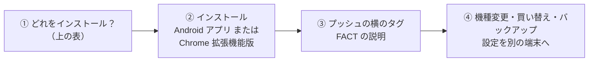
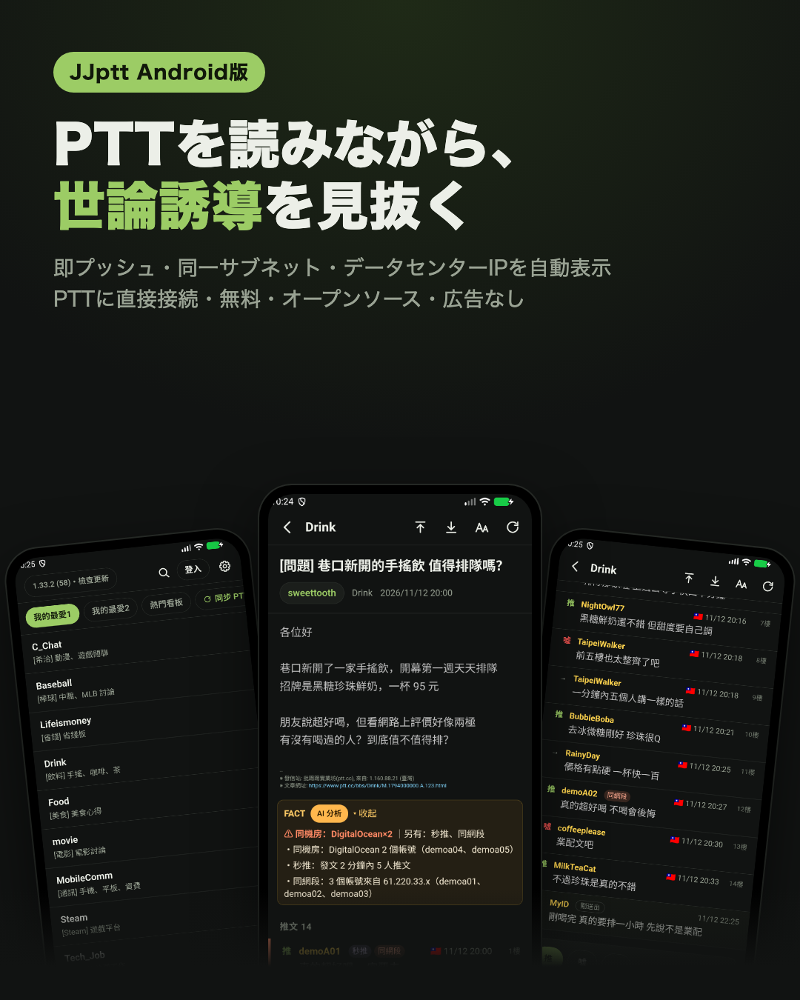
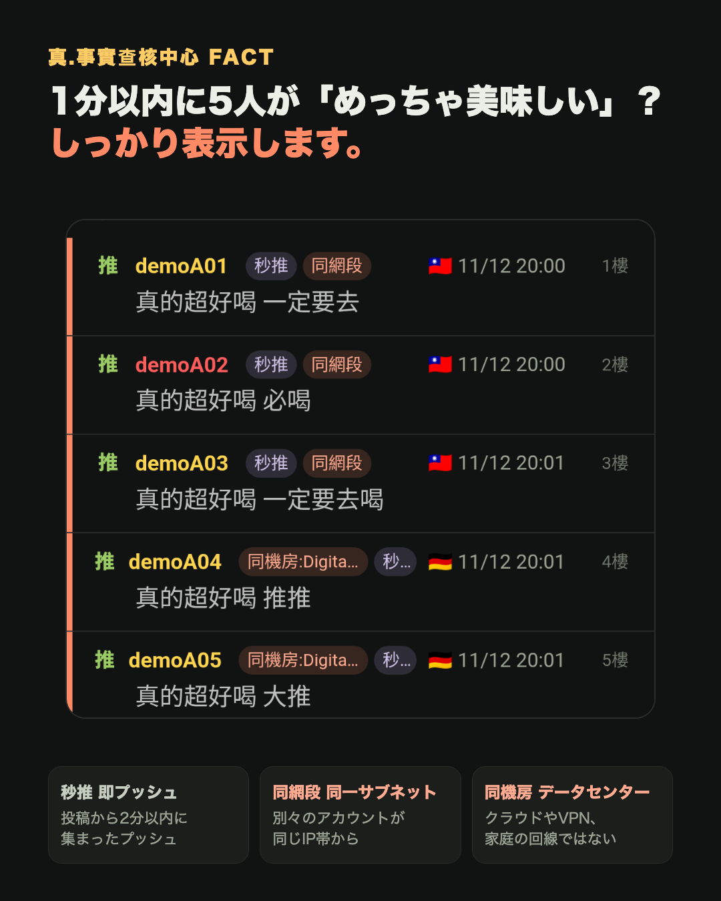
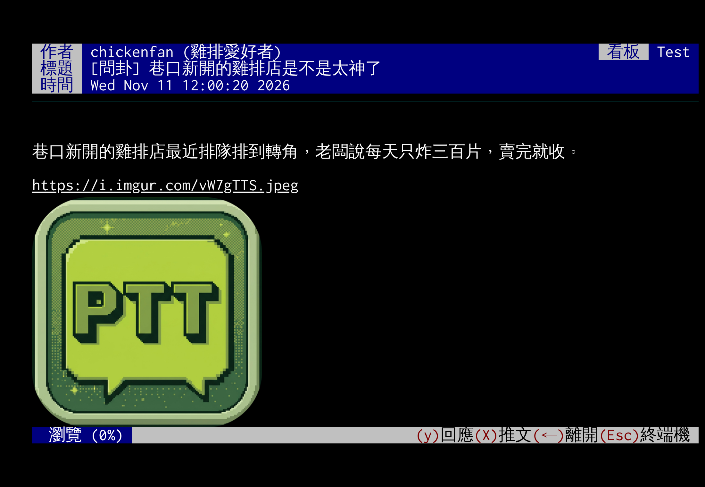

# JJptt

[中文](README.md) | [English](README.en.md) | **日本語**

[](https://github.com/killnopig/JJptt/releases/tag/android-stable) [](docs/desktop.ja.md) [](https://ko-fi.com/killnopig)

**JJptt は PTT を読むための無料ツールです。** PTT の記事を読みやすくし、「誰かが世論を誘導しているかもしれない」というしるしを見つけて表示します。

> PTT は台湾の大きなネット掲示板です。記事の下のコメントを「プッシュ」（推文）と呼びます。
> 「世論誘導」とは、何人かがわざと大量にコメントして、ある意見がみんなの意見であるかのように見せることです。

<a name="ダウンロード"></a>

## どれをインストールすればいい？

| 使っているもの | インストールするもの | 難しさ |
|---|---|---|
| **Android スマホ** | [Android アプリ](docs/android.ja.md) | かんたん：ファイルを1つダウンロードして開くだけ |
| **パソコン**（Chrome、Edge、Brave、Arc、Vivaldi ブラウザ） | [Chrome 拡張機能版](docs/desktop.ja.md) | 手順どおりに一度だけ、約5分 |
| **iPhone** | まだありません：[理由と応援の方法](docs/android.ja.md#ios-版について) | |

<a name="説明書"></a>

## 📚 説明書：この順番で読んでください



1. **どれをインストールするか決める**：上の「どれをインストールすればいい？」の表を見てください。
2. **説明どおりにインストールして使い始める**
   - スマホ：[Android アプリ](docs/android.ja.md)：ダウンロード、インストール、更新、アプリでできること。
   - パソコン：[Chrome 拡張機能版](docs/desktop.ja.md)：インストールの手順、はじめての使い方、更新方法、困ったとき。
3. **プッシュの横に「秒推」「同網段」などのタグが出て、意味を知りたい**：[FACT の説明](docs/fact.ja.md)。まず最初の「はじめに」と「用語集」を読んでください。
4. **機種変更、パソコンの買い替え、設定のバックアップ**：[設定を別の端末へ](docs/settings-file.ja.md)。
5. **最近何が変わったか**：[更新履歴](CHANGELOG.md)（中国語）。

## 誰が世論を誘導している？ JJptt ならひと目でわかる。

記事の下でみんなが賛成しているように見えても、実は少人数が示し合わせてコメントしていることがあります。たとえば：

- 1分以内に、5つのアカウントがほとんど同じことを言う。
- いくつものアカウントが同じ場所からネットにつないでいる。（ネットにつながる機器にはそれぞれ「IP」があり、ネット上の住所のようなものです。住所がとても近いなら、同じグループかもしれません。）
- コメントした人が海外の「データセンター」からつないでいる。ふつうの人はめったにそうしません。本当の居場所を隠すためによく使われます。

こうしたことは目で見ても気づきにくいものです。JJptt はプッシュのすぐ横に表示します。

<p align="center">
  
  
</p>

**無料・広告なし・データ収集なし。** プログラムはすべて公開されていて（オープンソース）、誰でも確認できます。（JJptt の画面は繁体字中国語です）

### JJptt を選ぶ理由

| | |
|---|---|
| 🔍 **[世論誘導を見抜く](docs/fact.ja.md)** | あやしいプッシュを自動で表示：早すぎるプッシュ、一度にどっと来る、同じ言葉、同じ場所やデータセンターから。自分で数える必要はありません |
| 🤖 **ワンタップで AI に聞く** | 記事全体を ChatGPT、Claude などの AI に見てもらえます。一部を選んで「これは事実？」と聞くこともできます |
| 🔒 **誰も間に入らない** | PTT に直接つなぎ、ほかの人のサーバーを通りません。ID とパスワードは自分のパソコンかスマホにだけ残ります |
| 📖 **読みやすい** | 画像・動画・ニュースが記事の中にそのまま表示されます。次の記事は先に読み込んでおくので、すぐ開きます |
| 🎨 **プッシュがひと目でわかる** | 階（何番目か）、国旗、同じ人が何回プッシュしたかを色分け。見たくない人はブラックリストに入れて、薄くしたり隠したりできます |
| 🔄 **設定を持ち運べる** | パソコンの設定をスマホに移せます。スマホで整えたレイアウトは短い「コード」にして友だちと共有できます |

## 📱 Android アプリ

> **Android アプリについて知りたい方へ**：ダウンロードすればすぐ使え、ほかに何もインストール不要。プッシュ・返信・投稿ができ、文章の一部を選んで AI に聞けます。パスワードはスマホに内蔵された金庫で暗号化。無料、約10MB。
>
> 👉 **[Android アプリの紹介とダウンロード](docs/android.ja.md)**：スクリーンショット、ダウンロードと更新、iPhone 版の予定

## 💻 Chrome 拡張機能版

「拡張機能」はブラウザに追加する小さな道具です。JJptt は PTT 本来の見た目（黒い背景、きれいに並んだ文字）のまま、読みやすい「閲覧モード」とファクトチェックを加えます。Chrome、Edge、Brave、Arc、Vivaldi で使えます。




- **閲覧モード**：画像・動画・ニュースを記事の中に表示。次の記事は先に読み込み。
- **使うほど便利に**：最新の記事が一番上。文章を選んで AI に聞けます。
- **設定を持ち運べる**：Google アカウントで同期、またはファイルに保存。新しいバージョンはワンクリックで更新。

**[Chrome 拡張機能版のインストールと使い方](docs/desktop.ja.md)**

<sub>画面はすべてデモです。記事・アカウント・IPは架空のものです。</sub>

## FACT（真.事實查核中心）

**FACT = Facts, Accuracy, Credibility & Truth（事実・正確・信頼・真実）。** 立場より証拠：どちらの側かは問わず、事実だけを問います。

- **タグが付いても工作員とは限りません。** タグは「この行動があるルールに当てはまる」という意味だけで、判断はあなたに任せます。
- **同じものさし**：政治的立場、誰か、どの団体かに関係なく、基準は同じです。
- **証拠を公開**：どのタグにも理由があり、レポートを開けば見られます。
- **訂正できる**：間違いはワンタップで外せ、どのルールもオン／オフや調整ができます。


👉 **[FACT の説明](docs/fact.ja.md)**：各タグの意味、なぜあやしいのか、自動ブラックリスト、間違っていたときは

## データ通信量について

閲覧モードは記事の画像をダウンロードするので、通信量が多めです。テザリング中や通信量に限りがあるときは、設定で「預先讀取時連圖片一起下載」（先読みで画像もダウンロード）をオフにしてください。詳しい数字と節約の方法：[拡張機能版の説明の「データ通信量」](docs/desktop.ja.md#データ通信量)。

インストール、はじめての使い方、更新方法、よくある質問、閲覧モードがある理由は、すべて [Chrome 拡張機能版の説明](docs/desktop.ja.md) にあります。

## 開発（プログラムを書く人向け）

JJptt は [iamchucky/PttChrome](https://github.com/iamchucky/PttChrome)（GPL-2.0）のフォークです。元のバージョンは提供終了した Chrome アプリで TCP 接続を開いていましたが、JJptt の拡張機能版はローカルヘルパーで直接接続します。ほかに、自分の Cloudflare Worker 中継サーバー（`worker/`）経由でPTTにつなぐウェブ版もあります。どちらも初期設定は SSH で、暗号化はブラウザの中で行います。

`dev.html` は `js/` のソースを直接読み込みます。`index.html` と拡張機能はまとめた `js/pttchrome.min.js` を使います：

```bash
npm install
npm run build
```

`npm run build` でサイトをまとめて `extension/` にコピーします。新しいバージョンを出すには：`js/changelog.js` の先頭に1件追加（バージョン、日付、変更内容）してから `npm run build`。バージョンは `package.json`、`extension/manifest.json`、`CHANGELOG.md` に自動で書き込まれます。

`npm test` で自動テストを実行します（Node だけで、追加のパッケージは不要）。テストは `test/run.js` にあり、FACT の連続プッシュのルール、一時ブラックリスト、同じURLの荒らし、そして各ルールが設定ページと中国語・英語の説明に漏れなくあるかを確認します。

Android アプリは `mobile/`（Capacitor）にあり、そこで `npm run build` するとまとめたページをアプリにコピーします。`mobile` ブランチに push するたびに CI が自動でビルドと署名を行い（`.github/workflows/android.yml`）、テスト済みのものを手動で正式版にします（`.github/workflows/android-stable.yml`）。

ローカルヘルパーのソースは `native-host/main.go` です。変更したら `sh native-host/build.sh` で全プラットフォームの実行ファイルを作り直します（Go が必要）。

## データの出典（プログラムを書く人向け）

IPの国データ（`data/geoip-v4.bin`）は [ip-location-db](https://github.com/sapics/ip-location-db) の geo-whois-asn-country を変換したもので、ライセンスは [CC BY 4.0](https://creativecommons.org/licenses/by/4.0/)、出典：[Number Resource Organization (NRO)](https://www.nro.net/)。更新方法は `tools/build-geoip.js` を参照してください。

データセンター／VPNのIPデータ（`data/hosting-v4.bin`）は ip-location-db の origin-asn から抽出したもので、[PDDL](https://opendatacommons.org/licenses/pddl/1-0/)（パブリックドメイン）、出典は各地域インターネットレジストリと Route Views / RIPE RIS の公開ルーティングデータです。更新方法は `tools/build-hosting.js` を参照してください。

## 謝辞

中正機械 MBA91 几啟成、わたしのミューズに感謝します。
