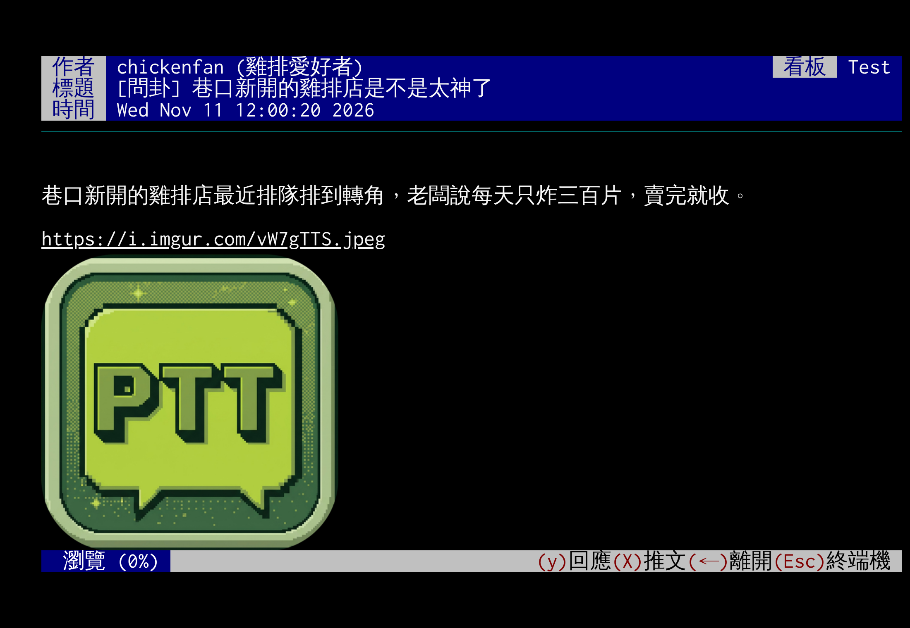
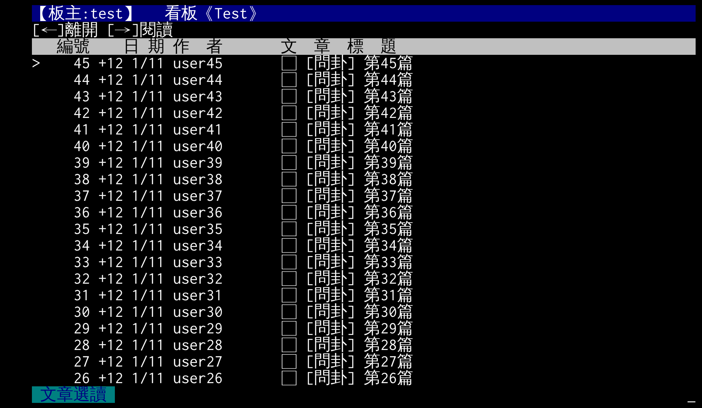

# JJptt

**在瀏覽器裡上 PTT，順手把帶風向的抓出來。**

- **直連、不經手**：擴充功能版用本機小程式直接連 ptt.cc，不經過任何轉接站，帳號密碼只留在你的電腦。
- **真.事實查核中心**：秒推、脈衝、補血、罐頭推文、同網段、機房／VPN IP、共伴效應、首殺班底——一篇文章底下的協同帶風向痕跡一眼看穿，還能一鍵交給 AI 判讀。
- **閱讀模式**：保留終端機的字型與手感，圖片、影片、新聞卡片直接夾在內文裡，上下篇預先讀好、秒開。
- **推文一目了然**：樓層、國旗、同 IP、推文多次的人各自上色，誰在洗版、誰在接力，不用數。
- **名單隨你管**：黑名單、觀察名單、自訂「網軍」名單，淡化或隱藏、隨時開關；同一網址洗版自動封鎖 24 小時。
- **越用越順手**：最新文章排最上面、Z 搜尋自動帶推文數、選字就能問 AI 是不是事實。
- **設定帶著走**：Google Drive 同步、匯出成檔案；有新版按一下就自動更新、自動重開。

免費、開源（GPL-2.0），不上架、不收集任何資料。




<sub>以上為示範畫面，帳號與內容都是虛構的。</sub>

### 流量提醒

- 終端機畫面很省：只傳文字，看一整天大約幾 MB。
- 閱讀模式比較耗：每篇文章要從 PTT 網頁版下載，一般 50～300 KB，推文上千則的爆文可能超過 1 MB；捲到圖片和網址預覽時才會載入，每張圖從幾十 KB 到幾 MB 不等。
- 預先讀取預設連圖片一起下載（設定 → 一般 →「預先讀取時連圖片一起下載」）：換篇最快，但流量會多很多——上下 5 篇時，每換一篇大約多下載 10 篇的文字和它們的所有圖片；取消勾選就只抓文字。
- 用手機熱點或流量有限時：取消「預先讀取時連圖片一起下載」、勾「閱讀模式用低解析度圖片」、把「預先讀取上下幾篇」調成 0 或 1，或暫時關掉閱讀模式。

## 安裝教學（約 5 分鐘，只要做一次）

JJptt 是 Chrome 擴充功能，加上一個連線用的「本機小程式」。兩個都裝好才能用。
支援電腦版的 Chrome、Edge、Brave、Arc、Vivaldi；手機不行。

### Mac

**步驟 1：打開「終端機」**

按 `⌘ + 空白鍵`，輸入「終端機」（或 Terminal），按 Enter。會出現一個可以打字的視窗，下面的指令都是**複製貼上到這裡，再按 Enter**。

**步驟 2：下載 JJptt**

```bash
cd ~ && git clone https://github.com/killnopig/JJptt.git
```

- 如果跳出「需要安裝命令列開發者工具」，按「安裝」，等它裝完再貼一次上面的指令。
- 完成後，你的「家目錄」（Finder 左邊有房子圖示的那個）裡會多一個 `JJptt` 資料夾。

**步驟 3：安裝本機小程式**

```bash
sh ~/JJptt/native-host/install.sh
```

看到「安裝完成」就好了。

**步驟 4：把 JJptt 加進 Chrome**

1. 在 Chrome 網址列輸入 `chrome://extensions` 按 Enter（Edge 是 `edge://extensions`）。
2. 打開右上角的「**開發人員模式**」。
3. 按左上角「**載入未封裝項目**」。
4. 在跳出的視窗按 `⌘ + Shift + G`，貼上 `~/JJptt/extension`，按 Enter，再按「選擇」。
5. 出現 JJptt 的卡片就成功了。

**步驟 5：重開 Chrome**

按 `⌘ + Q` 完全關閉 Chrome，再重新打開。點網址列右邊的拼圖圖示 → 在 JJptt 旁邊按圖釘，以後點工具列上的 JJptt 圖示就能開。

### Windows

**步驟 1：安裝 Git**

到 <https://git-scm.com/download/win> 下載安裝，一路按「Next」用預設值就好。

**步驟 2：下載 JJptt**

按 `Windows 鍵`，輸入 `cmd`，打開「命令提示字元」，貼上下面這行按 Enter：

```bat
cd %USERPROFILE% && git clone https://github.com/killnopig/JJptt.git
```

完成後，`C:\Users\你的名字\JJptt` 會多一個資料夾。

**步驟 3：安裝本機小程式**

打開那個 `JJptt` 資料夾 → `native-host` → 雙擊 `install.bat`。

**步驟 4、5：** 跟 Mac 的步驟 4、5 一樣。選資料夾時選 `JJptt` 裡面的 `extension`；重開瀏覽器要把所有視窗都關掉。

## 第一次使用

1. 點工具列上的 JJptt 圖示，會開一個新分頁並連上 PTT（預設走加密的 SSH）。
2. 像平常一樣輸入帳號、密碼。想自動登入：在畫面上**按右鍵 → 設定 → 自動登入與其他**。
3. 進看板、開文章就會自動用「閱讀模式」顯示圖片和推文分析。按 `Esc` 回到原本的終端機畫面。
4. 所有功能的開關都在**右鍵 → 設定**；抓網軍相關的在「真.事實查核中心」。


想讓最新的文章排在最上面：設定 → 排版 → 勾「文章列表最新的在上面」。



## 怎麼更新

- 有新版時，JJptt 畫面上方會出現提示，按「**立即更新**」就會自動下載並重新開啟。
- 也可以打開設定，按左下角的「**更新 JJptt**」。
- 按鈕不能用的話：Mac 雙擊 `JJptt` 資料夾裡的 `update-jjptt.command`，Windows 雙擊 `update-jjptt.bat`，再回到 JJptt 按「套用更新」。

## 常見問題

**點了 JJptt 圖示，畫面一直連不上**
本機小程式沒裝好，或裝完沒有完全關閉瀏覽器。重新做一次步驟 3，然後 `⌘ + Q`（Windows 關掉所有視窗）再重開。

**忘記 JJptt 資料夾放在哪裡**
打開 `chrome://extensions` → JJptt 卡片的「詳細資料」→ 往下找「來源」，那個路徑去掉最後的 `/extension` 就是。

**想同步到另一台電腦**
設定 → 同步、備份與更新 → 「連結 Google 帳號」，或「匯出設定檔」再到另一台「從檔案匯入」。帳號密碼不會同步。

**怎麼移除**
在 `chrome://extensions` 移除 JJptt，再移除本機小程式：Mac 在終端機執行 `sh ~/JJptt/native-host/install.sh --uninstall`，Windows 雙擊 `native-host\uninstall.bat`。最後刪掉 `JJptt` 資料夾。

**本機小程式安全嗎**
它只會連到 `ptt.cc` / `ptt2.cc`，只接受 JJptt 擴充功能呼叫；「立即更新」時也只會在 JJptt 資料夾下載 GitHub 上的新版。原始碼在 `native-host/main.go`。

## 為什麼要有閱讀模式

PTT 本身是 80 × 24 字的文字終端機，這個限制讓幾件事在終端機裡做不好：

- **看不到圖**：終端機只能顯示文字，文章裡的圖片、影片、新聞連結都只是一串網址，要一個一個點開，看完再切回來。閱讀模式把它們直接顯示在內文中，往下捲就看完。
- **一次只看得到一頁**：長文章和幾百則推文要一頁一頁翻。閱讀模式把整篇文章放在同一頁，可以順順地捲、隨意跳到任何位置。
- **推文分析需要整篇**：樓層、同 IP 多帳號、與作者同 IP、推文多次的人、罐頭推文這些判斷要看到全部推文才準確。終端機一次只看到一頁，閱讀模式一開就拿到整篇。
- **複製、查證不方便**：在終端機選字會跨到畫面框線和格式字元。閱讀模式可以直接選取、複製，也可以把選取的文字或整篇文章交給 AI 查證。
- **換篇要等**：在終端機看下一篇要等 PTT 一頁一頁送過來。閱讀模式會預先讀取上下幾篇，換篇幾乎不用等。

它刻意保留終端機的字型、顏色和 80 字寬，按鍵也跟 PTT 一樣（↑↓ 捲動、←／Esc 離開、X 推文、y 回文），所以用起來仍然是 PTT，只是多了圖片和整篇閱讀。不想用的話，可以在 設定 → 一般 關掉；網頁版沒有的看板（例如需要登入才看得到的）會自動留在終端機畫面。

## 進階（給會寫程式的人）

JJptt fork 自 [iamchucky/PttChrome](https://github.com/iamchucky/PttChrome)（GPL-2.0）。原版要靠已停用的 Chrome App 開 TCP 連線；JJptt 的擴充功能版改用本機小程式直接連線，另外也有網站版，透過自己的 Cloudflare Worker 轉接站（`worker/`）連到 PTT。兩種都預設走 SSH，加密在瀏覽器裡完成。

### 網站版（需要自己部署轉接站）

```bash
cd worker
npx wrangler login
npx wrangler deploy
```

把部署出來的 `https://jjptt-relay.<你的子網域>.workers.dev` 填進網頁第一次跳出的輸入框（或設在 `js/app_conn.js` 的 `lib.DEFAULT_RELAY_URL`）。允許使用轉接站的網頁網址設在 `worker/wrangler.toml` 的 `ALLOWED_ORIGINS`。

防濫用限制：每個 IP 每分鐘最多 10 條新連線（`wrangler.toml` 的 `[[ratelimits]]`）；每條連線上傳平時 16 KB/秒、可瞬間衝到 256 KB（`worker/src/index.js` 的 `UPLOAD_*`）。

### 自己 fork 時的 Google 同步設定

JJptt 已經填好自己的 Google 用戶端 ID，一般使用者不用做這段。自己 fork 的人要到 [Google Cloud Console](https://console.cloud.google.com/)：

1. 建立專案，「API 和服務」→「程式庫」→ 啟用 **Google Drive API**。
2. 設定 OAuth 同意畫面（目標對象「外部」，把要用的 Gmail 加進「測試使用者」）。
3. 「用戶端」→「建立用戶端」→「網頁應用程式」：JavaScript 來源 `https://<你的帳號>.github.io`，重新導向 URI `https://<擴充功能 ID>.chromiumapp.org/`。
4. 把用戶端 ID 填進 `js/drive_sync.js` 的 `DriveSync.CLIENT_ID`，再 `npm run build`。

### 開發

`dev.html` 直接載入 `js/` 的原始碼；`index.html` 和擴充功能用打包後的 `js/pttchrome.min.js`：

```bash
npm install
npm run build
```

`npm run build` 會打包網站並複製到 `extension/`。發佈新版本：在 `js/changelog.js` 最上面加一筆（版本號、日期、改了什麼），再 `npm run build`，版本號會自動寫進 `package.json`、`extension/manifest.json` 和 `CHANGELOG.md`。

本機小程式的原始碼在 `native-host/main.go`，改完用 `sh native-host/build.sh` 重新編譯所有平台的執行檔（需要 Go）。

### 資料來源

IP 國籍資料（`data/geoip-v4.bin`）由 [ip-location-db](https://github.com/sapics/ip-location-db) 的 geo-whois-asn-country 轉換而來，資料授權為 [CC BY 4.0](https://creativecommons.org/licenses/by/4.0/)，來源：[Number Resource Organization (NRO)](https://www.nro.net/)。更新方式見 `tools/build-geoip.js`。

機房／VPN IP 資料（`data/hosting-v4.bin`）由 ip-location-db 的 origin-asn 篩選而來，資料為 [PDDL](https://opendatacommons.org/licenses/pddl/1-0/)（公有領域），來源為各區域網路註冊機構與 Route Views / RIPE RIS 的公開路由資料。更新方式見 `tools/build-hosting.js`。

## 致謝

感謝中正機械 MBA91 几啟成，我的 MUSE。
