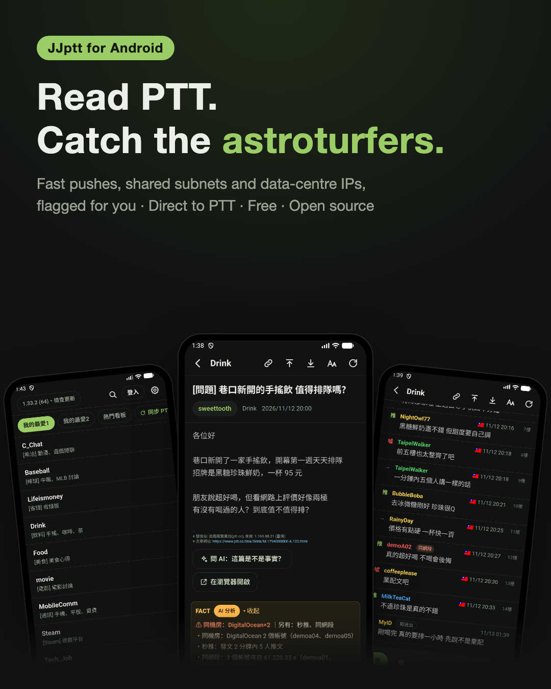
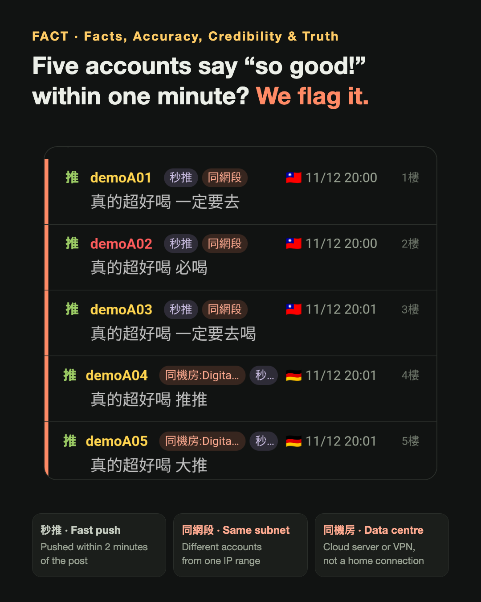
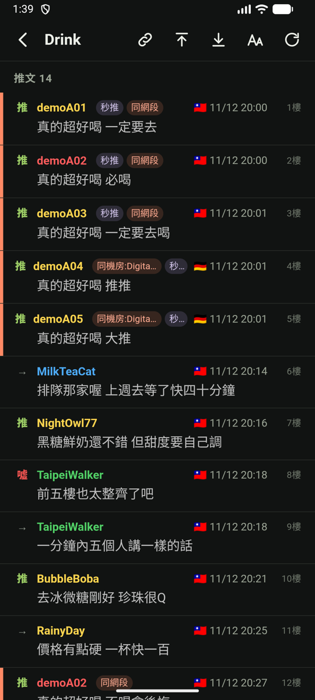
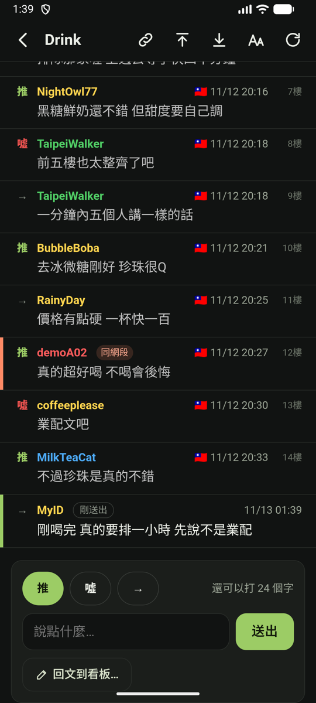
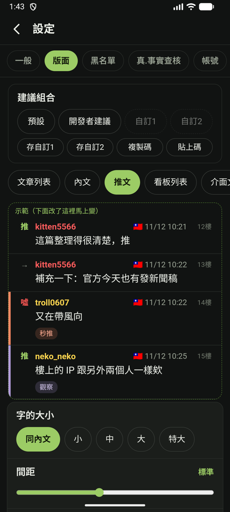

# JJptt for Android

[中文](android.md) | **English** | [日本語](android.ja.md)

← [Back to JJptt](../README.en.md)

JJptt now has an Android app. It connects to PTT by itself — no local helper to install, and no relay server in between.

- **FACT**: fast pushes, shared subnets, data-centre IPs… tagged right next to each push, and one tap hands the article to AI.
- **Push, reply, post**: your push shows up the moment PTT takes it (marked 「剛送出」, "just sent") — no waiting for the web page to catch up.
- **Easy reading**: images and news cards inside the article; previous / next can float on the left or right edge for one-handed reading; your PTT favourites sync in one tap.
- **Your layout**: text size, line spacing and push style, with a live preview on top; save a layout as a code and share it with friends.
- **Same settings as the desktop**: a settings file exported from the extension imports straight into the app.
- **Your account stays safe**: the password is encrypted with an Android Keystore key on the phone and never backed up to the cloud.
- **Ask AI, share, in one tap**: select a passage and ask AI "is this true?", or hand the whole article to ChatGPT, Claude, Perplexity, Grok or Copilot; copy the article's address in one tap, or open it in the browser.

  
  
  
  

FACT report ｜ what's odd about each push ｜ your push, at once ｜ live layout preview

## Download and update

1. On your phone, open the [JJptt Android release page](https://github.com/killnopig/JJptt/releases/tag/android-stable) and tap `JJptt.apk` (about 10 MB).
2. Open the downloaded file to install. The first time, Android asks you to allow installing apps from unknown sources.
3. New versions: in the app, **設定 → 關於 →「檢查並自動更新」** (Settings → About → Check and update). One tap; settings and login are kept.

To try changes still being tested: 設定 → 關於 → turn on 「**接收測試版**」 (Receive test builds).

Android 7.0 and later. Not on Google Play — install from the release page above.

## About an iOS version

Many people have asked for an iPhone version, and I'd love to make one. Most of the code can be reused, but publishing an iOS app requires joining Apple's Developer Program (US$99 a year), and an iPhone to test the direct PTT connection and pushing.

JJptt has always been a free, ad-free side project, and that cost isn't covered yet. If JJptt is useful to you and you'd like to help make the iOS version happen, you're welcome to [buy me a coffee on Ko-fi](https://ko-fi.com/killnopig) — any amount, entirely optional, and no feature depends on it. Once the developer account is covered, I'll start, and share the progress here.

The articles, accounts and IPs in the promo images are fictional demo data.
