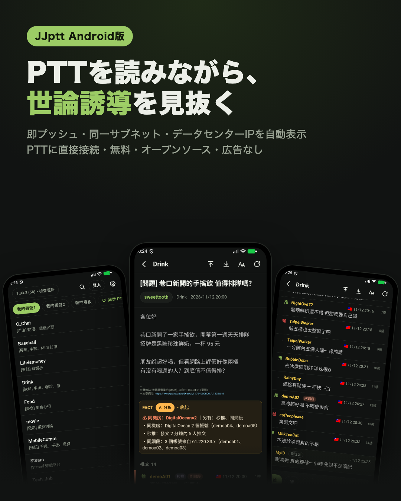
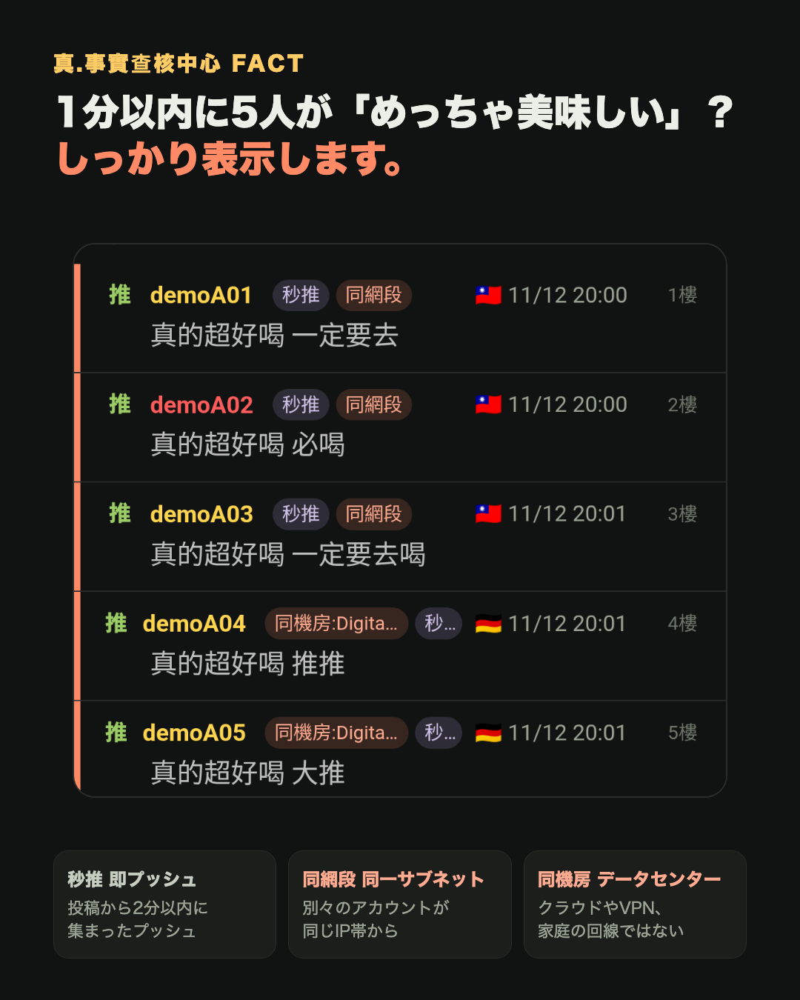
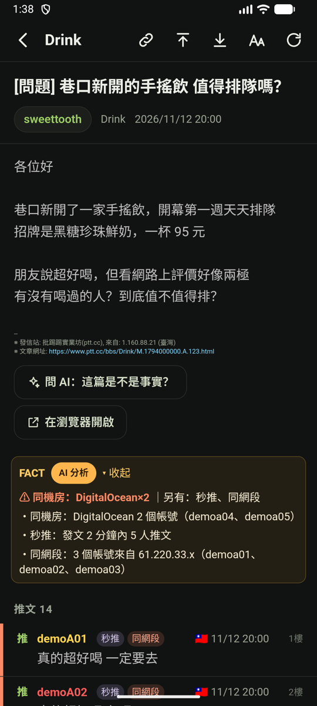
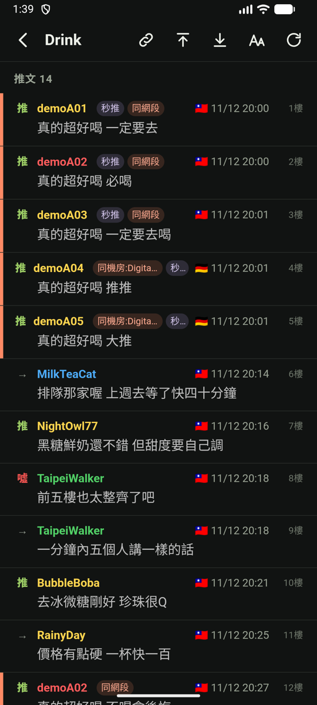
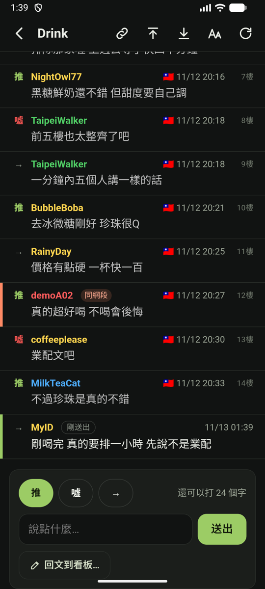
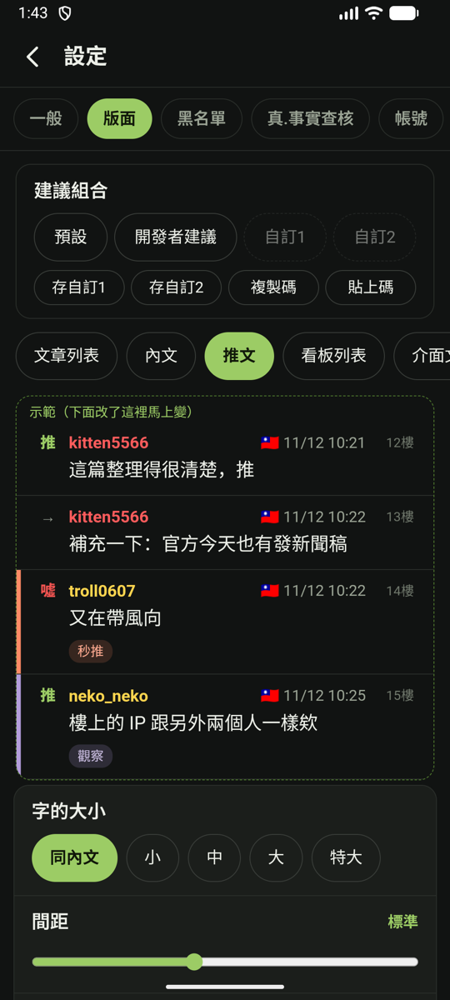

# JJptt Android アプリ

[中文](android.md) | [English](android.en.md) | **日本語**

← [JJptt のトップへ](../README.ja.md)

JJptt に Android アプリができました。ダウンロードすればすぐ使え、ほかに何もインストール不要です。アプリが PTT に直接つなぎ、ほかの人のサーバーを通りません。

- **FACT**：即プッシュ、同一サブネット、データセンターのIP…を各プッシュの横に直接表示し、ワンタップでAIに判定させられます。荒らすアカウントは24時間自動で薄く表示（[ルールの説明](fact.ja.md)）。
- **プッシュ・返信・投稿**：PTTが受け付けた瞬間に自分のプッシュが表示されます（「剛送出」＝送信済み）。PTT のウェブサイト（www.ptt.cc）の更新を待つ必要はありません。
- **読みやすく、めくりやすい**：画像やニュースカードを本文に表示。前／次の記事ボタンを左右に浮かせて片手でめくれます。PTTのお気に入りもワンタップで同期。
- **レイアウトは自由に**：文字サイズ、行間、プッシュの見た目を変更でき、上部でリアルタイムにプレビュー。決めたレイアウトは短い「コード」（設定 → 版面 →「複製碼」）にして友だちと共有できます。
- **Chrome 拡張機能版と設定を共有**：拡張機能で書き出した設定ファイルをそのままアプリに読み込め、逆もできます（[移し方](settings-file.ja.md)）。
- **アカウントも安全**：パスワードはスマホに内蔵された金庫（Android Keystore）で暗号化し、そのスマホにだけ保存。クラウドにはバックアップされません。
- **AIへの質問も共有もワンタップ**：文章を選んで「これは事実？」とAIに聞いたり、記事全体を ChatGPT、Claude、Perplexity、Grok、Copilot に渡したり。記事のURLはワンタップでコピー、ブラウザで開くこともできます。

  
  
  
  

FACT レポート ｜ 各プッシュの疑わしい点 ｜ 送ったらすぐ表示 ｜ レイアウトのプレビュー

## ダウンロードと更新

1. スマホで [JJptt Android 正式版のダウンロードページ](https://github.com/killnopig/JJptt/releases/tag/android-stable) を開き、`JJptt.apk` をタップしてダウンロードします（約10MB）。APK は Android アプリのインストール用ファイルです。
2. ダウンロードしたファイルを開いてインストールします。
   - 初回は「提供元不明のアプリのインストール」を許可するか聞かれるので、許可してください。
   - 聞かれる理由：JJptt は Google Play に出していません。Google Play 以外からアプリを入れるときは、いつも一度確認されます。
   - Android 8 以降では、この許可はダウンロードに使ったアプリ（Chrome や「ファイル」など）だけに与えられ、ほかのアプリが勝手にインストールできるようにはなりません。
3. 新しいバージョンが出たら：アプリの **設定 → 關於 →「檢查並自動更新」**（設定 → このアプリについて → 確認して自動更新）をタップするだけ。設定とログインはそのまま残ります。

テスト中の修正をいち早く試したい場合：設定 → 關於 →「**接收測試版**」（テスト版を受け取る）をオンにしてください。

Android 7.0 以降に対応。Google Play には出していないので、上のダウンロードページからインストールしてください。

**データ通信量**：記事を読むと、中の画像もダウンロードします。モバイルデータや通信量に限りがあるときは、設定 → 一般 →「閱讀」（閲覧）で「預先讀取時連圖片一起下載」（先読みで画像もダウンロード）をオフ、「用低解析度圖片」（低解像度の画像）をオンにしてください。

## iOS 版について

iPhone 版はないのかとよく聞かれますし、私もぜひ作りたいと思っています。コードの大部分は使い回せますが、iOS アプリを公開するには Apple Developer Program への登録（年額99米ドル）が必要で、PTTへの直接接続やプッシュを試すための iPhone も必要です。

JJptt はずっと無料・広告なしの個人プロジェクトで、この費用のめどはまだ立っていません。JJptt を気に入っていただけて、iOS 版の実現を応援してくださる方は、[Ko-fi でコーヒーを一杯](https://ko-fi.com/killnopig) おごっていただけるとうれしいです。金額は自由、まったくの任意で、どの機能にも影響しません。開発者アカウントの費用が集まったら作り始め、進み具合はまたここでお知らせします。

紹介画像の記事・アカウント・IPはすべてデモ用の架空のデータです。
