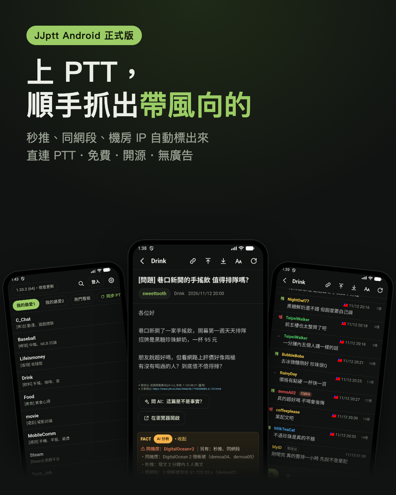
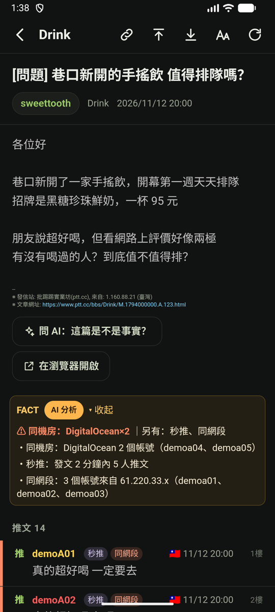
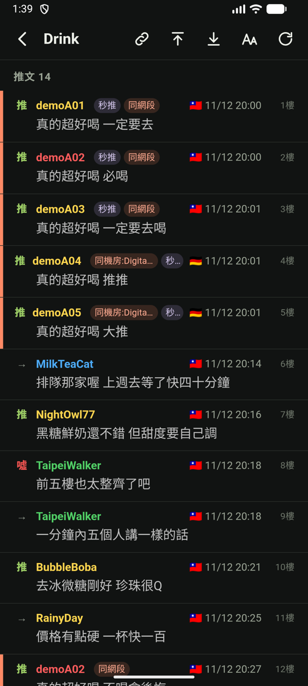
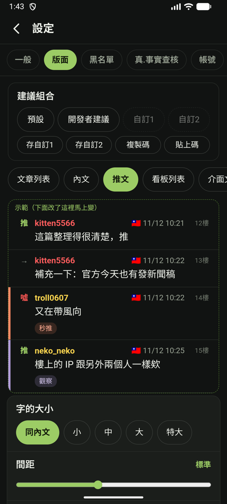

# JJptt Android App

**中文** | [English](android.en.md) | [日本語](android.ja.md)

← [回 JJptt 首頁](../README.md)

JJptt 也有 Android App 了：App 自己連 PTT，不用裝本機小程式，也不經任何轉接站。

- **真.事實查核中心**：秒推、同網段、機房 IP……直接標在推文旁邊，還能一鍵交給 AI 判讀；洗版的人自動淡化 24 小時（[規則說明](fact.md)）。
- **推文、回文、發文**：推完馬上看到自己的推文（標「剛送出」），不用等網頁版更新。
- **好讀、好翻**：圖片、新聞卡片夾在內文裡；上一篇／下一篇可以浮在左右兩側，單手就能翻；我的最愛一鍵從 PTT 同步。
- **版面隨你調**：字級、行距、推文樣式都能改，上方即時預覽；調好的版面可以存成設定碼分享給朋友。
- **跟電腦版共用設定**：擴充功能匯出的設定檔，手機可以直接匯入。
- **帳號安全**：密碼用 Android 的金鑰加密保存在手機裡，不會備份到雲端。
- **問 AI、分享都一鍵**：選一段文字就能問 AI「這是不是事實？」，也能整篇交給 ChatGPT、Claude、Perplexity、Grok 或 Copilot；文章網址一鍵複製，或用瀏覽器開啟。

  
  
  
  

FACT 報告 ｜ 每則推文的疑點 ｜ 推完馬上看到 ｜ 版面即時預覽

## 下載與更新

1. 用手機打開 [JJptt Android 正式版下載頁](https://github.com/killnopig/JJptt/releases/tag/android-stable)，點 `JJptt.apk` 下載（約 10 MB）。
2. 打開下載的檔案安裝。第一次會要你允許「安裝不明來源的應用程式」。
3. 之後有新版：App 裡 **設定 → 關於 →「檢查並自動更新」**，按一下就好，設定和登入都會保留。

想搶先試還在測試的修改：設定 → 關於 → 打開「**接收測試版**」。

支援 Android 7.0 以上；沒有上架 Google Play，請從上面的下載頁安裝。

## 關於 iOS 版

很多人問有沒有 iPhone 版，其實我也很想做。程式大部分可以沿用，但 iOS App 要上架，得先加入 Apple 的開發者計畫（每年 99 美元），也需要一支 iPhone 來測試直連 PTT 和推文這些功能。

JJptt 一直是免費、沒有廣告的業餘專案，這筆費用目前還沒有著落。如果你覺得 JJptt 好用，也願意幫忙促成 iOS 版，歡迎到 [Ko-fi 請我喝杯咖啡](https://ko-fi.com/killnopig)——金額不拘、完全自由，不影響任何功能。湊到開發者帳號的費用我就開工，進度會再跟大家分享。

宣傳圖裡的文章、帳號和 IP 都是示範用的虛構資料。
