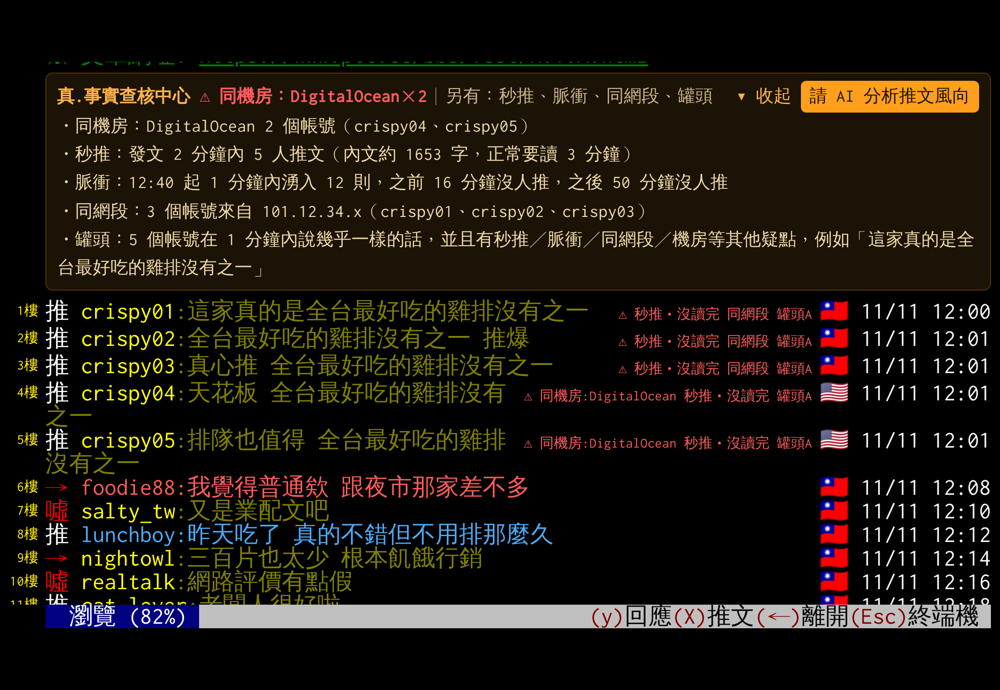
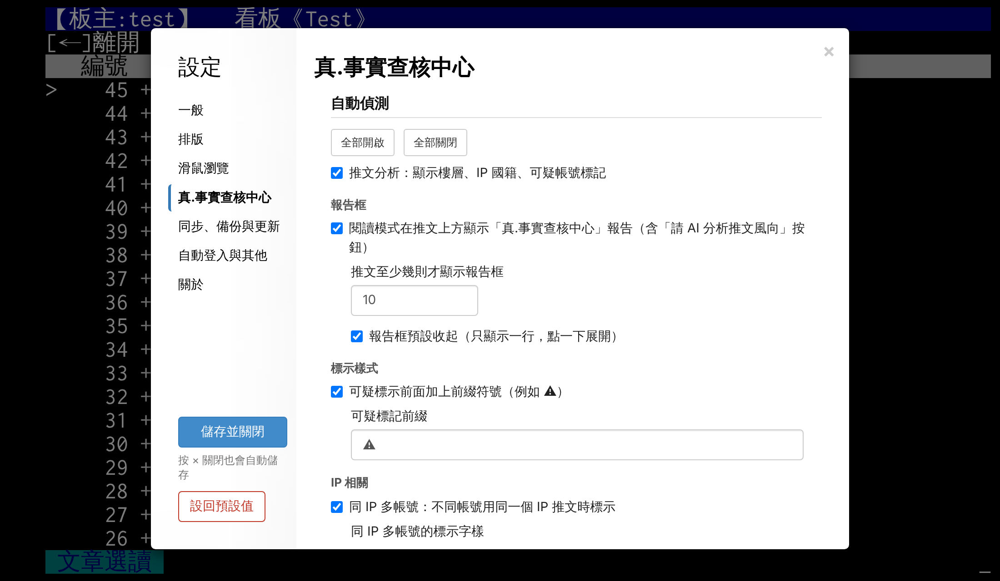

# FACT (真.事實查核中心)

[中文](fact.md) | **English** | [日本語](fact.ja.md)

← [Back to JJptt](../README.en.md)

**FACT = Facts, Accuracy, Credibility & Truth.** Coordinated opinion pushing is common in PTT's comment ("push") sections: a row of near-identical pushes within one minute, several accounts from one IP range, pushes coming from an overseas data centre. You can't count these by hand on PTT. JJptt puts the **evidence** next to each push and fades out accounts that flood. **The rules look only at behaviour, never at the side someone takes.**

FACT does three things:

1. **Detect**: each push is tagged with what looks off, and a report sits above the pushes.
2. **Act**: accounts that flood are put on the blacklist for 24 hours, faded or hidden.
3. **Undo**: every entry says why; a mistake is removed in one tap, and every rule can be switched off or given your own threshold.

The Chrome extension and the Android app use the same rules. (JJptt's interface is in Traditional Chinese; the tag names below are what you see on screen.)

## Principles

- **One ruler**: the standard never changes with political leaning, identity or organisation. The rules look only at behaviour: when someone pushed, what they wrote, which IP they came from.
- **Open evidence**: every tag can say why (shared IP, data centre, fast push…); open the report to see which accounts and which numbers.
- **Open to checking**: anyone flagged by mistake can be taken off the automatic blacklist; every rule can be switched on or off with your own threshold; and one tap hands the whole article to AI for a second look.
- **Only your own screen**: FACT never reports anyone and never changes what others see on PTT. The history it compares against stays on your own computer or phone.

## 1. Detect: tags next to each push

When an article has enough pushes (10 by default), a one-line **FACT report** appears between the article and the pushes; open it for the full report. Its **AI 分析** (AI analysis) button hands the article and its pushes to the AI you choose (ChatGPT, Claude, Perplexity, Grok, Copilot or your own).

Default thresholds are in brackets; all of them can be changed in the settings.

### Timing: when they pushed

| Tag | When |
|---|---|
| **秒推** (fast push) | Pushed within minutes of posting (2 by default). If the article is too long to have been read, it says 「秒推‧沒讀完」 (fast push, not read). The author's own additions don't count |
| **脈衝** (burst) | A quiet article suddenly gets a wave of pushes within a minute or two (at least 6, with 5+ quiet minutes around it), tagged 脈衝1, 脈衝2… Articles that are busy all along don't count |
| **補血** (boosting) | Boos outnumber pushes, then comes a long run of very short plain pushes (15 or more in a row), tagged 「補血?」 |
| **門檻推文** (threshold pushes) | The count climbs to about 10 — where the article list starts showing the push count — and stops: 10–12 pushes, all within 5 minutes of posting, then nothing for 2+ hours, and the first 10 are plain pushes of 5 characters or fewer |

### IP: where they pushed from

| Tag | When |
|---|---|
| **機房** (data centre) | The IP belongs to a cloud or VPN provider (34 of them: AWS, Google Cloud, DigitalOcean, M247…), tagged 機房:provider; two or more accounts from the same provider are tagged 同機房:provider and listed on the report's first line |
| **同網段** (shared subnet) | Different accounts whose IPs share the first three parts (e.g. 101.12.34.x); tagged when 3 or more |
| **同 IP** (shared IP) | Different accounts pushing from the same IP |
| **與作者同 IP** (same IP as the author) | The pusher and the article's author use the same IP |

### Content: what they wrote

| Tag | When |
|---|---|
| **罐頭** (canned) | Different accounts saying almost the same thing within a short time (10 minutes): at least 5 accounts, 60%+ of the words shared, at least 6 characters in a row identical — not counting quotes of the title or the article, or relay games. It turns red as 「罐頭A」 only when at least 2 of those accounts are also tagged fast push, burst, boosting, shared subnet or data centre; merely similar wording is grey, 「同梗」 (same meme) |

### Across articles: accounts that keep showing up together

These need several articles to tell, so they get better the longer you use JJptt. The history stays on your own device.

| Tag | When |
|---|---|
| **共伴** (co-occurring) | In the articles where A pushes, B is often (70%+) within 3 floors of A; A's push is tagged 共伴:B. A must have appeared in at least 5 articles |
| **首殺班底** (first-push squad) | On one author's articles, an account keeps pushing within 2 minutes of posting (at least 3 articles, and more than half of them) |
| **門檻班底** (threshold squad) | The same account is among the first 10 pushes of several (2 or more) 門檻推文 articles, tagged 門檻班底(N篇) |

## 2. Act: the automatic blacklist

Detection only tags. Two behaviours get in the way of reading, so JJptt **puts the account on the blacklist for 24 hours**:

| Rule | When | For |
|---|---|---|
| **連推** (flooding) | One account pushes too many times in a row in one article (10 or more by default), tagged 連推N. A run interrupted by others still counts if the next push is within 3 floors and 2 minutes; the author replying in their own article doesn't count | 24 hours |
| **Same-URL spam** | One account posts the same URL in more than 3 articles within 24 hours | 24 hours |

[公告] (announcement) and [測試] (test) articles, and replies to them, don't count for flooding.

You choose how blacklisted accounts look: **faded** (still visible, default), **hidden**, or **shown as usual** (the blacklist paused, the list kept).

Besides the automatic rules you keep three lists yourself:

- **Blacklist**: people you'd rather not read, faded or hidden.
- **Watchlist**: people you're not sure about yet, marked next to their pushes, with notes.
- **Custom list**: named by you (say, "shills"), its name shown next to their pushes.

## 3. Undo: when it gets it wrong

- **Every entry is recorded**: the automatic blacklist shows why, the URL, which article, when it was added and how long is left.
- **It expires by itself**: after 24 hours the entry is gone.
- **Remove in one tap**: think it's wrong? Press 移除 (remove). Anyone you remove by hand isn't added back by the rules for 24 hours.
- **Make it permanent**: press 改成永久 to move the account to your own blacklist.
- **Every rule can be tuned**: switch each rule on or off and set its threshold, or switch them all at once.
- **Ask AI again**: not sure? Press AI 分析 on the report and let AI read the whole thing.

## Where the settings are

| | Detection rules, thresholds | Automatic blacklist, lists |
|---|---|---|
| **Desktop** | Right-click → 設定 (Settings) →「真.事實查核中心」→ 自動偵測 (detection) | 名單 (lists), at the top of the same page |
| **Android app** | 設定 →「真.事實查核」 | 設定 →「黑名單」→ 自動黑名單 |

A settings file exported from the extension imports straight into the app, lists and rules included (not your ID or password).

## Questions

**Does a tag mean the account is a paid shill?**
No. A tag only means "this behaviour matches a rule"; a fast push may just mean someone was online. FACT lays the evidence out and leaves the call to you; the more tags and rules line up, the more it's worth a look.

**Why only 24 hours on the automatic blacklist?**
Flooding and spamming are usually a moment's thing. 24 hours clears the screen without hiding someone forever over one mistake. If you really don't want to see them, make it permanent.

**Does it affect anyone else?**
No. FACT changes only your own screen; it never reports anyone. An article is sent to the AI you chose only when you press AI 分析 yourself.

**Why do some tags only appear after a while?**
共伴, 首殺班底 and 門檻班底 compare several articles. JJptt builds up that history as you read (on your device only).

Demo screens; articles, accounts and IPs are fictional.
